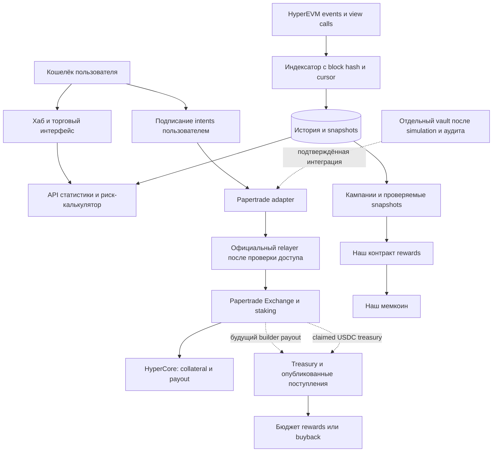

# Архитектура полного продукта

Один продукт на HyperEVM, единый интерфейс и общий read-only индексатор. Денежные модули имеют отдельные разрешения, лимиты и условия включения. Название и параметры нового мемкоина пока не выбраны.

Пунктир — условные денежные интеграции. Кошелёк treasury и vault не используют подписи или PAPER сторонних пользователей.

## Модули

**Хаб.** Профиль адреса, trade history, realized net PnL, PAPER/staked PAPER, реально distributed/claimed USDC, available и queued balances. Данные с временем актуальности и блоком; APR не публикуется без истории выплат и допущений. Начальный рейтинг — завершённые полезные действия и участие с ограничениями, а volume/loss метрики показываются отдельно.

**Терминал.** BTC/ETH и риск-калькулятор; wallet connection добавляем после read-only версии. Trade adapter должен знать EIP-712 domain, types, nonce, expiry, market ID, relayer endpoint, intent status и cancel semantics. Session key ограничен областью применения; стратегия может потерять средства через trading даже если key не умеет withdraw. Пользователь видит способ revoke и восстановления прямого withdrawal. Ни сайт, ни API не принимают приватные ключи пользователей.

**Rewards.** Наш токен или points/NFT на первом пилоте; никакого обещания «буст к PAPER emissions». Boost можно дать только в нашей программе. Snapshot определяется фиксированным блоком и опубликованным правилом; один и тот же address/event нельзя повторно начислять. Для токена — claim с проверяемым proof, бюджетом, сроком и защитой повторного claim. Anti-sybil до токена проверяется на локальных replay; одного количества кошельков недостаточно.

**Treasury.** Независимый адрес, публичные источники поступлений, расходы и фактические buybacks. Политика: reserve на расходы и ликвидность → заранее определённый бюджет rewards/buyback. Mint своего токена и новые депозиты не отображаются как profit. Multisig и ограничение параметров treasury нужно проектировать отдельно от governance Papertrade.

**Vault.** Сначала симулятор и стратегия на собственном капитале, затем отдельный пользовательский vault. Интеграция smart-contract wallet с relayer и staking требует доказательства, включая EIP-1271/поддерживаемый альтернативный путь. Если совместимости нет, отключаем public vault; управляемая человеком treasury не называется автономным on-chain vault.

USDC находится в разных контурах HyperEVM/HyperCore и внутренних balances Exchange. Стандартный синхронный vault над ERC-20 не покрывает bridging, settlement и queued payouts. Нужны явные состояния pending deposit, available collateral, margin, queued claim, pending withdrawal и final withdrawal.

Непередаваемый PAPER не обеспечивает обычный cash redeem. Default liquid NAV исключает PAPER и queued debt; их размеры показываются отдельно. Правила распределения остаточных требований, impairment и выхода должны быть определены до депозита. Нельзя возвращать номинал вышедшим вкладчикам за счёт новых депозитов или оценивать PAPER по произвольной цене. При нехватке USDC нужен честный запрос выхода с ожиданием и описанным распределением рисков.

## Стек и границы

| Компонент | Выбор | Статус |
|---|---|---|
| Read-only chain client | TypeScript + viem | Установлен и проверен |
| Экономическая модель | TypeScript; сценарии и тесты | Базовая модель готова |
| Web app | Next.js + React; wallet library после adapter spike | Запланирован |
| История | PostgreSQL + детерминированный indexer | Запланирован |
| Dev database | Docker Compose либо локальная PostgreSQL | Выбрать при этапе хаба |
| Smart contracts | Solidity + Foundry + проверенные библиотеки | После верификации ABI и vault feasibility |
| CI | typecheck, tests, index replay, fork tests | Настроить при появлении модулей |

Для финансовых сумм — bigint/fixed-point. Floating-point из текущего симулятора применяется только для иллюстраций, не для заявок, deposits, rewards или NAV.

Индексатор хранит chain ID, block hash, tx hash, log index и номер ABI/implementation. Требуются idempotence, replay и обработка reorg. Upgrade implementation или неизвестный event приводит к проверке adapter и отключению соответствующих write-модулей, а не молчаливой интерпретации по старой схеме.

Feature flags сами по себе не обеспечивают финансовую безопасность. Перед денежным этапом ограничения должны исполняться сервером/контрактом: allowed markets, notional, leverage, daily loss, total treasury allocation, отсутствие trade от queued balances по умолчанию и остановка при недоступности relayer/устаревших данных. Точные лимиты выбрать из stress tests и бюджета; начальный leverage не брать из максимума протокола.
